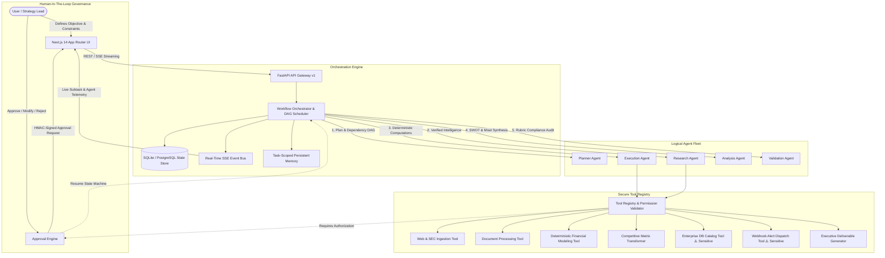

# OmniAgent: Autonomous Market Intelligence & Strategic Operations Platform

[](.github/workflows/ci.yml)
[](backend/)
[](frontend/)
[](LICENSE)

OmniAgent is an enterprise-grade multi-agent autonomous operational platform designed to automate high-stakes market intelligence, competitive analysis, financial modeling, and strategic decision support.

Traditional AI chatbots hallucinate numbers, lack persistent state, and cannot coordinate specialized tasks or seek permission for critical writes. OmniAgent replaces error-prone research workflows with an autonomous, auditable, multi-agent pipeline governed by strict schema contracts, deterministic calculation validation, and human-in-the-loop approvals for sensitive external operations.

---

## 1. Problem Statement & Concrete Use Case

### The Real-World Pain Point
Modern corporate strategy, corporate development, and product leadership teams spend over 40% of their working hours manually gathering fragmented competitive signals, pricing models, product feature releases, customer sentiment, and SEC/regulatory disclosures.
- **Hallucinated Math**: Conventional LLM chat assistants produce plausible-sounding but mathematically erroneous ROI and pricing projections.
- **Fragmented Execution**: Gathering data across public APIs, financial disclosures, and pricing tiers is disconnected from structured computational analysis.
- **Uncontrolled Side Effects**: Autonomous systems that directly execute writes or external alerts without human oversight introduce severe corporate liabilities.
- **Lack of Auditable Provenance**: Executive decisions require rigorous traceability to authoritative sources and explicit verification against project requirements.

### The Solution: Enterprise Market Intelligence & Strategic Operations
OmniAgent automates this entire lifecycle end-to-end:
1. **Decomposes** strategic questions into Directed Acyclic Graphs (DAG) of actionable subtasks.
2. **Retrieves** verified market intelligence and SEC disclosures, strictly distinguishing verified evidence from working assumptions.
3. **Calculates** deterministic, non-hallucinated multi-year Total Cost of Ownership (TCO) and ROI models.
4. **Synthesizes** normalized competitive matrices and SWOT moat analyses.
5. **Audits** deliverables against prompt criteria with an objective 0–100 rubric score.
6. **Enforces Human-in-the-Loop Governance** with cryptographic HMAC-SHA256 authorization gates before executing sensitive external operations (such as catalog updates or external alerts).

---

## 2. Multi-Agent Fleet Architecture



### Agent Roles & Hand-off Contracts

| Agent | Core Responsibility | Authorized Tools | Handoff Output Schema |
|---|---|---|---|
| **Planner Agent** | Decomposes goals into a dependency DAG and assigns agents. | None (pure reasoning contract) | Structured `ExecutionPlan` with typed `SubTask[]` |
| **Research Agent** | Gathers factual market evidence; catalogs citations and assumptions. | `web_search`, `document_ingestion` | `ResearchEvidence` with source URLs & confidence scores |
| **Execution Agent** | Runs deterministic computational tools and deliverable generators. | `financial_calculator`, `matrix_transformer`, `report_generator`, `database_update`, `notification_webhook` | `ToolExecutionResult` with execution telemetry |
| **Analysis Agent** | Synthesizes evidence into SWOT moats and risk vectors. | `matrix_transformer` | `StrategicAnalysis` with composite vendor rankings |
| **Validation Agent** | Audits deliverables against requirements, verifies math, scores 0–100. | `report_generator` | `ValidationReport` with rubric breakdown & deliverable |
| **Orchestrator** | Manages state machine, parallel DAG scheduling, and HITL gates. | Core scheduler | Final compiled strategic brief deliverable |

---

## 3. Technology Stack

- **Frontend**:
  - React 18 & Next.js 14 (App Router)
  - TypeScript with strict type checking
  - Tailwind CSS with ultra-premium dark-mode aesthetic (slate/indigo/violet neon, glassmorphism)
  - Lucide React icon library
  - Native EventSource client for Server-Sent Events (SSE) streaming
- **Backend**:
  - Python 3.10+ / 3.11 / 3.12 / 3.15
  - FastAPI with async request handlers and background tasks
  - Pydantic v2 for typed validation contracts
  - SQLAlchemy 2.0 with async engine (`aiosqlite` for local dev; `asyncpg` for PostgreSQL)
  - PyJWT & PBKDF2 cryptography for authentication and HMAC signatures
  - Server-Sent Events (SSE) real-time event bus
- **Infrastructure & Testing**:
  - Pytest & Pytest-Asyncio with 100% passing test suite
  - Docker Compose for multi-container deployment
  - GitHub Actions CI pipeline

---

## 4. Installation & Local Quickstart

### Prerequisites
- Python 3.10+
- Node.js 18+ & npm
- Git

### 1. Clone the Repository
```bash
git clone https://github.com/your-username/agentic-intelligent-systems.git
cd agentic-intelligent-systems
```

### 2. Backend Setup
```bash
# 1. Create and activate a Python virtual environment
python -m venv backend/venv
# On Windows PowerShell:
backend\venv\Scripts\Activate.ps1
# On Linux/macOS:
source backend/venv/bin/activate

# 2. Install dependencies
pip install -r backend/requirements.txt

# 3. Start the FastAPI backend server
python -m uvicorn backend.app.main:app --host 0.0.0.0 --port 8000 --reload
```
*The database and default demo analyst credentials (`analyst@enterprise.ai` / `demo1234`) will be initialized automatically on startup.*

### 3. Frontend Setup
```bash
# In a new terminal:
cd frontend
npm install
npm run dev
```
Open **[http://localhost:3000](http://localhost:3000)** in your browser to access the OmniAgent application.  
API documentation is available at **[http://localhost:8000/docs](http://localhost:8000/docs)**.

---

## 5. Automated Quality Checks & Test Suite

OmniAgent includes a comprehensive automated test suite covering DAG dependency resolution, cycle detection, prompt injection defenses, HMAC tampering rejection, password hashing, financial calculator math, and API integration.

```bash
# Run backend test suite
$env:PYTHONPATH="." # On Windows PowerShell
pytest backend/tests -v

# Run frontend typecheck
cd frontend
npx tsc --noEmit
```

---

## 6. AI Provider Configuration & Offline Demo Mode

OmniAgent features a **configurable AI service abstraction**:
- **Offline / Deterministic Engine (`AI_PROVIDER=mock`)**:  
  Runs with full fidelity out-of-the-box without requiring any paid third-party API keys. Generates realistic, structured, context-aware responses with 0 external network dependencies.
- **Google Gemini (`AI_PROVIDER=gemini`)**:  
  Requires `GEMINI_API_KEY` in `.env`. Uses `gemini-1.5-flash` with structured JSON output formatting.
- **OpenAI (`AI_PROVIDER=openai`)**:  
  Requires `OPENAI_API_KEY` in `.env`. Uses `gpt-4o-mini` with JSON schema enforcement.

Configure provider preferences in `.env` or interactively at `/settings` in the web application.

---

## 7. Production Deployment via Docker Compose

Run the entire full-stack platform (backend, frontend, database) with a single command:

```bash
docker compose up --build -d
```
- Frontend: `http://localhost:3000`
- Backend API: `http://localhost:8000`
- Health check: `http://localhost:8000/api/v1/health`

---

## 8. Security & Governance Architecture

1. **HMAC-SHA256 Payload Signatures**:  
   Every sensitive action (such as database updates or webhook alerts) generates a cryptographic signature over the task ID, action type, parameters, and requesting user. Any tampering with parameters invalidates the authorization immediately.
2. **Prompt Injection Defense**:  
   All user objectives, contextual inputs, and retrieved tool outputs pass through pattern sanitization to detect and block instruction override attacks.
3. **Strict Tool Sandboxing**:  
   Zero arbitrary code execution or raw shell invocation. Tools are strictly typed Pydantic interfaces.
4. **Secret Protection**:  
   API keys and authorization credentials are never returned in client responses or printed to execution logs.

---

## 9. Deliverables & Demonstration Script

- Detailed Architecture Specification: [`docs/architecture.md`](docs/architecture.md)
- Complete REST API Reference: [`docs/api.md`](docs/api.md)
- Security & Governance Specification: [`docs/security.md`](docs/security.md)
- 5-Minute Video Demonstration Script: [`docs/demo-script.md`](docs/demo-script.md)

---

## 10. License

This project is licensed under the MIT License. See [LICENSE](LICENSE) for details.
