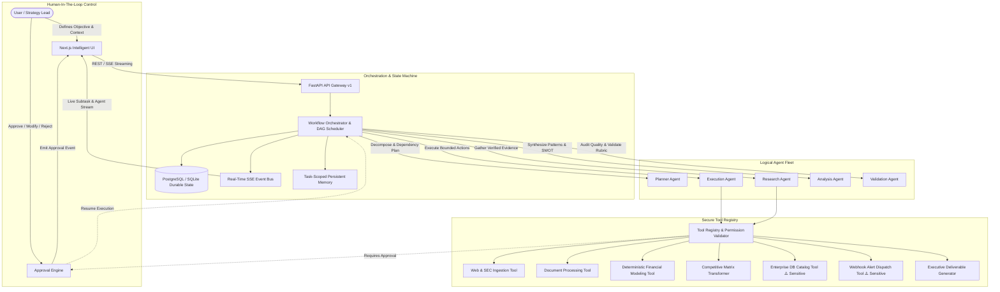

# OmniAgent: Autonomous Market Intelligence & Strategic Operations System
## Architecture & Technical Specification

### 1. System Overview

**OmniAgent** is an enterprise-grade multi-agent operational platform designed to automate high-stakes market intelligence, competitive analysis, financial modeling, and strategic decision support.

The system replaces manual, error-prone research workflows with an autonomous, auditable, multi-agent pipeline governed by strict schema contracts, deterministic calculation validation, and human-in-the-loop approvals for sensitive external operations.



---

### 2. Logical Agent Fleet & Contracts

Every agent in OmniAgent adheres to typed Pydantic contracts with strict input schemas, execution budgets, and output validation:

| Agent | Responsibility | Authorized Tools | Handoff Artifact |
|---|---|---|---|
| **Planner Agent** | Decomposes user goal into Directed Acyclic Graph (DAG) with dependency ordering and token budget estimation. | None (pure reasoning & schema decomposition) | `ExecutionPlan` with typed `SubTask[]` |
| **Research Agent** | Gathers factual market intelligence, competitive disclosures, and pricing tiers; strictly separates facts from assumptions. | `web_search`, `document_ingestion` | `ResearchEvidence` with source URLs & confidence scores |
| **Execution Agent** | Runs deterministic computational tools, formats matrices, generates deliverable files, and dispatches external alerts. | `financial_calculator`, `matrix_transformer`, `report_generator`, `database_update`, `notification_webhook` | `ToolExecutionResult` with status, data, and artifacts |
| **Analysis Agent** | Synthesizes cross-competitor evidence, identifies market moats, performs SWOT modeling, and scores competitive threats. | `matrix_transformer` | `StrategicAnalysis` with SWOT, moat ratings, risk vectors |
| **Validation Agent** | Audits final and intermediate deliverables against user objectives, verifies numerical accuracy, and detects unverified claims. | `financial_calculator` (cross-check) | `ValidationReport` with score (0-100), pass/fail, critique |
| **Orchestrator** | State machine controller, manages DAG readiness, schedules parallel tasks, intercepts sensitive tool calls, and handles retries. | Core system scheduler | Final workflow resolution & deliverable package |

---

### 3. Workflow State Machine

The orchestration engine implements an explicit, persistent finite state machine:

```
[ PENDING ] ───▶ [ PLANNING ] ───▶ [ AWAITING_APPROVAL ] (Optional Plan Sign-off)
                       │                          │
                       │ Approved                 ▼
                       ▼                   [ CANCELLED ]
                 [ RUNNING ] ◀────────────────────┤
                   ▲     │                        │
        Resume     │     ▼ Sensitive Tool Call    │
        ────────── [ AWAITING_APPROVAL ]          │
                         │                        │
                         ▼ Rejected               │
                   [ CANCELLED / FAILED ]         │
                         ▲                        │
                         │ Bounded Retries (>3)   │
                         └────────────────────────┘
                   [ RUNNING ] ───▶ [ COMPLETED ]
                         │
                         ▼ User Pause
                   [ PAUSED ] ───▶ [ RUNNING ]
```

1. **`pending`**: Task received, initial objective validated, task-scoped memory initialized.
2. **`planning`**: Planner Agent decomposes the objective into subtasks and dependencies.
3. **`awaiting_approval`**: Workflow halts if human approval is enabled for the plan or when an agent invokes a sensitive tool (`database_update` or `notification_webhook`).
4. **`running`**: Ready subtasks are dispatched (parallel execution for independent nodes; sequential for dependent ones).
5. **`paused`**: User manually pauses the workflow; can be resumed at any point.
6. **`completed`**: All subtasks executed, Validation Agent passes deliverable (score >= 80), final report compiled.
7. **`failed`**: Unrecoverable error encountered or retry limit (3 attempts) exceeded.
8. **`cancelled`**: Workflow aborted by user or sensitive action rejected.

---

### 4. Human-in-the-Loop (HITL) Security Model

All operations capable of external side effects are classified by security level:

- **READ_ONLY / SAFE**: `web_search`, `document_ingestion`, `financial_calculator`, `matrix_transformer`, `report_generator`. Can run autonomously.
- **SENSITIVE / DESTRUCTIVE**: `database_update`, `notification_webhook`, or high-stakes plan execution.
- **Approval Verification Token**: Every approval request generates an HMAC-signed SHA-256 payload hash combining:
  `action_name + task_id + json(parameters) + requested_by_user`.
  If the parameters or context change before approval, the token is invalidated immediately.

---

### 5. Memory & Context Architecture

- **Working Memory**: Task-scoped ephemeral context containing active step artifacts, scratchpads, and intermediate tool results.
- **Persistent Evidence Store**: Deduplicated citations, source documents, verified facts, and assumptions flagged by Research Agent.
- **Audit Log**: Immutable chronological ledger of all events, tool inputs/outputs, model latency, token consumption, and human approvals.
- **Access Boundary**: Strict multi-tenant isolation keyed by `user_id` and `workspace_id`.
